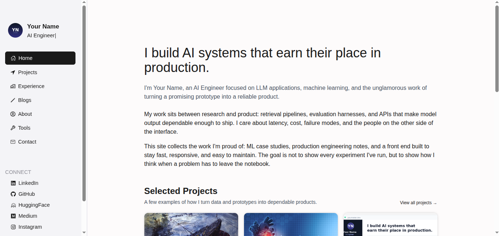

# Developer Portfolio

A responsive, framework-free portfolio template for developers and AI engineers.

[Live Demo](https://dev-portfolio26.vercel.app/) · [Source Code](https://github.com/BaqerHussaini/developer-portfolio)

[](LICENSE)



## Features

- Seven top-level pages: Home, Projects, Experience, Blogs, About, Tools, and Contact.
- Four project case studies and three long-form blog articles.
- Responsive sidebar that becomes an accessible mobile drawer with focus management, Escape-to-close, and `inert` support.
- Light and dark themes with the preference persisted in `localStorage`.
- Typewriter role animation that respects `prefers-reduced-motion`.
- Client-side category filters for projects and blog posts.
- Scroll-driven progress timeline on the Experience page.
- Local CSS, JavaScript, and image assets with no runtime dependencies.
- No build step, package manager, or framework required.

## Tech Stack

| Layer | Technology |
| --- | --- |
| Markup | HTML5 |
| Styling | CSS3, custom properties, responsive media queries |
| Behavior | Vanilla JavaScript (ES5-compatible IIFEs) |
| Typography | Inter via Google Fonts |
| Media | Local PNG, JPEG, WebP, and SVG assets |
| Tooling | None: no package manager, bundler, or build step |

## Getting Started

The project is fully static, so there is nothing to install or build. Clone the repository and serve the project root with any static file server.

### Prerequisites

- A modern web browser.
- Python 3 (optional, for the local development server).

### Run Locally

```bash
git clone https://github.com/BaqerHussaini/developer-portfolio.git
cd developer-portfolio
python3 -m http.server 8000
```

Open [http://localhost:8000](http://localhost:8000) in your browser.

On Windows, use `py -m http.server 8000` if `python3` is not available. You can also open `index.html` directly, but a local server is recommended so relative URLs resolve consistently.

## Available Scripts

This repository has no `package.json` and defines no npm, pnpm, or Yarn scripts.

| Script | Command | Description |
| --- | --- | --- |
| — | — | No scripts are defined; this is a static HTML site. |

## Environment Variables

None. The site does not read environment variables and does not include a `.env` file.

The active theme is stored in `localStorage` under the key `portfolio-theme`.

## Customization

- Replace the placeholder name, biography, social links, and contact details in `index.html` and the files under `pages/`.
- Update the rotating role labels in `assets/js/typewriter.js`.
- Adjust colors, radii, and design tokens in `assets/css/base.css`.
- Add or edit project and article cards in `pages/projects.html` and `pages/blogs.html`.
- Replace `assets/images/profile.jpg` and the preview images under `assets/images/` with your own assets.

## Project Structure

```text
.
├── index.html
├── pages/
│   ├── about.html
│   ├── blogs.html
│   ├── contact.html
│   ├── experience.html
│   ├── projects.html
│   ├── tools.html
│   ├── blogs/
│   └── projects/
├── assets/
│   ├── css/
│   ├── images/
│   └── js/
├── LICENSE
└── README.md
```

## Deployment

The live site is deployed on Vercel at [dev-portfolio26.vercel.app](https://dev-portfolio26.vercel.app/). The repository contains no deployment configuration because the project requires no build step.

To deploy your own copy, import the repository into Vercel, select the "Other" framework preset, leave the build command empty, and use the repository root as the output directory. Any static hosting provider works the same way.

## Contributing

Contributions are welcome. Fork the repository, create a focused branch, make your changes, and verify the layout in both light and dark mode before opening a pull request. There is currently no `CONTRIBUTING.md`.

## License

Released under the [MIT License](LICENSE). Update the copyright holder in `LICENSE` before publishing a customized copy.
